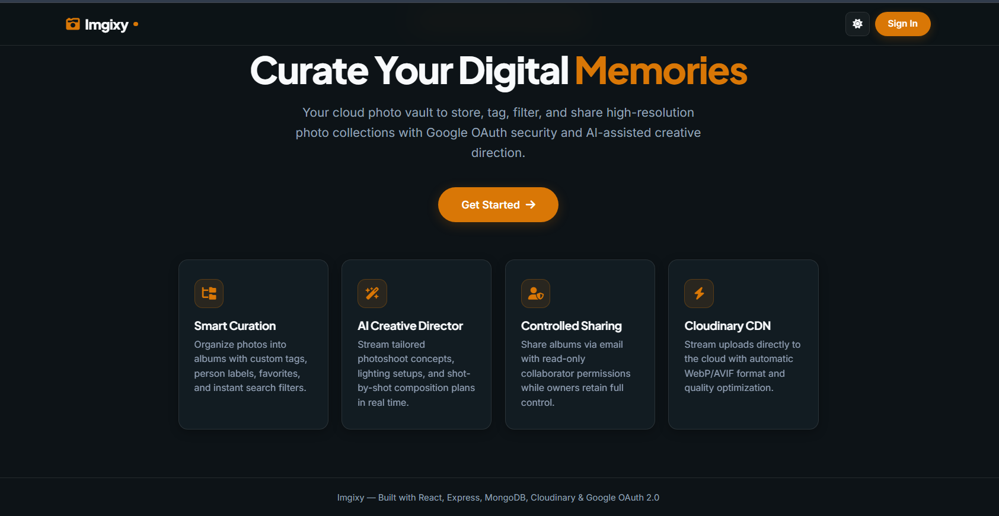

# Imgixy — Cloud Photo Vault & AI Creative Studio

Imgixy is a full-stack cloud image management system where users can securely upload, curate, and share photo collections. It uses **Google OAuth 2.0** for identity authentication and **JWT** for stateless API authorization. Photos are streamed directly to **Cloudinary** with dynamic edge optimization (`f_auto,q_auto`), while metadata—such as tags, person labels, favorites, comments, and collaborator permissions—is managed in **MongoDB**. It also includes an **AI Creative Director** powered by Server-Sent Events (SSE) for generating bespoke photoshoot and curation plans.

---

## Live Demo & Walkthrough

- **Live Demo:** [https://imgixy-1f4i.vercel.app/](https://imgixy-1f4i.vercel.app/)
- **Walkthrough Video (5–7 mins):** [Watch on Google Drive](https://drive.google.com/file/d/1I6qPh8k2N3v797tYNQmUhBB3up818tEe/view?usp=sharing)

---

## Preview



---

## Key Features

### Authentication & Security
- **Google OAuth 2.0 Sign-In:** One-click sign-in via Google Identity Services.
- **Stateless JWT Protection:** All album and image routes are guarded by Bearer token verification.
- **Role-Aware Access Control:** Album owners have full CRUD and sharing rights; invited collaborators receive read-only access and cannot delete albums or photos.

### Album Management
- Create, edit, and delete photo albums (deleting an album cleans up all associated images).
- Share albums with multiple collaborators via comma-separated email addresses with validation and deduplication.
- Filter workspace by **All Albums**, **My Albums**, and **Shared with Me**, plus instant search by name or description.

### Image Upload & Curation
- Drag-and-drop photo uploader with instant thumbnail preview, file size display, and MIME/size validation (JPG, PNG, GIF, WebP).
- Direct memory-buffer streaming to Cloudinary CDN.
- Rich metadata support: comma-separated tags, person tagged, favorite (star) status, file size, upload timestamp, and comments.
- Client-side instant filtering by **Favorites**, **Tags**, **Person/Filename search**, and sorting (**Newest**, **Oldest**, **Name A–Z**, **File Size**).
- **Full-Screen Photo Lightbox & Inspector:** View original-resolution images, inspect metadata, toggle favorites, post comments, and navigate with keyboard arrows (`←` / `→` / `Esc`).

### AI Creative Director
- Select a **Photo Style**, **Album Theme**, and **Showcase Slot Count** to stream a structured photoshoot and curation plan over **Server-Sent Events (SSE)**.

### UI / UX
- **Light & Dark Theme Switcher:** Persistent theme toggle with high-contrast tokens across all pages and modals.
- Fully responsive layout across mobile (`320px+`), tablet (`768px+`), and desktop (`1280px+`).

---

## Tech Stack

- **Frontend:** React 19, TypeScript, Vite, React Router v7, Axios, Bootstrap 5 + Custom CSS Design System, React Toastify
- **Backend:** Node.js, Express.js (ES Modules), MongoDB & Mongoose, Passport.js (`passport-google-oauth20`), JSON Web Tokens (`jsonwebtoken`), Multer & Streamifier, Cloudinary SDK, OpenAI SDK (OpenRouter SSE)

---

## API Endpoints

### Auth
- `GET /auth/google` — Initiate Google OAuth 2.0 flow
- `GET /auth/google/callback` — OAuth callback & JWT redirect

### Albums
- `POST /albums` — Create a new album
- `GET /albums` — Get all owned and shared albums
- `PUT /albums/:id` — Update album details (owner only)
- `POST /albums/:id/share` — Share album with collaborator emails (owner only)
- `DELETE /albums/:id` — Delete album and associated images (owner only)

### Images
- `POST /images/:albumId` (alias: `POST /albums/:albumId/images`) — Upload image with metadata
- `GET /images/:albumId` (alias: `GET /albums/:albumId/images`) — Get all images in an album (supports `?tags=tag1,tag2`)
- `GET /images/:albumId/favorites` (alias: `GET /albums/:albumId/images/favorites`) — Get favorite images in an album
- `PUT /images/:imageId/favorite` (alias: `PUT /albums/:albumId/images/:imageId/favorite`) — Star or unstar an image
- `POST /images/:imageId/comment` (alias: `POST /albums/:albumId/images/:imageId/comments`) — Add a comment to an image
- `DELETE /images/:imageId` (alias: `DELETE /albums/:albumId/images/:imageId`) — Delete an image (owner only)

### AI Creative Director
- `GET /ai/chat/sdk/plan` — Stream aesthetic curation plan via SSE
- `POST /ai/chat/sdk/plan/generate` — Stream aesthetic curation plan via SSE

---

## Local Setup & Installation

### 1. Clone the Repository
```bash
git clone https://github.com/Sourabhpande532/Imgixy.git
cd Imgixy
```

### 2. Configure Environment Variables

Copy `server/.env.example` to `server/.env`:
```env
PORT=5001
MONGO_URI=your_mongodb_connection_string
JWT_SECRET=your_jwt_secret
GOOGLE_CLIENT_ID=your_google_client_id
GOOGLE_CLIENT_SECRET=your_google_client_secret
CALLBACK_URL=http://localhost:5001/auth/google/callback
CLOUDINARY_NAME=your_cloudinary_cloud_name
CLOUDINARY_API_KEY=your_cloudinary_api_key
CLOUDINARY_API_SECRET=your_cloudinary_api_secret
FRONTEND_URL=http://localhost:5173
OPENROUTER_API_KEY=your_openrouter_api_key
```

Copy `client/.env.example` to `client/.env`:
```env
VITE_API_URL=http://localhost:5001
```

### 3. Install Dependencies & Run

**Start the Backend Server:**
```bash
cd server
npm install
npm start
```

**Start the Frontend Development Server:**
```bash
cd client
npm install
npm run dev
```

### Available Frontend Scripts (`client/`)
- `npm run dev` — Start Vite development server
- `npm run build` — Run TypeScript typecheck and build production bundle
- `npm run lint` — Run ESLint verification
- `npm run preview` — Preview production build locally

---

## Contact

For questions, bug reports, or feature requests, reach out to [sourabhpande43@gmail.com](mailto:sourabhpande43@gmail.com).
